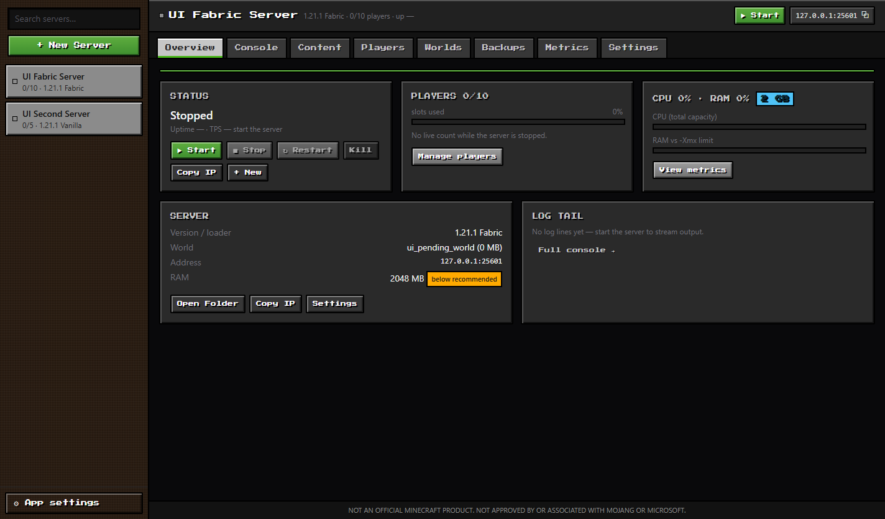
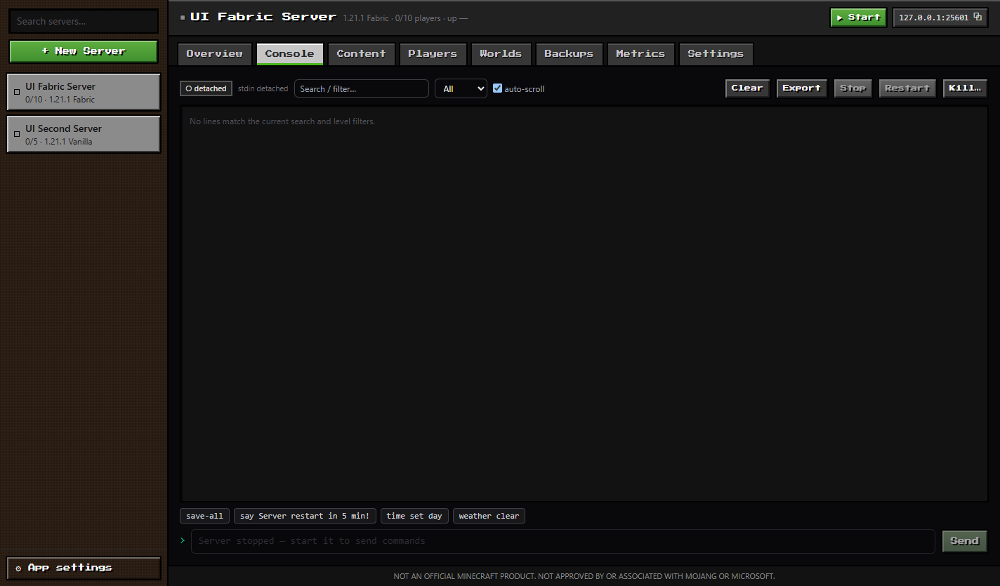
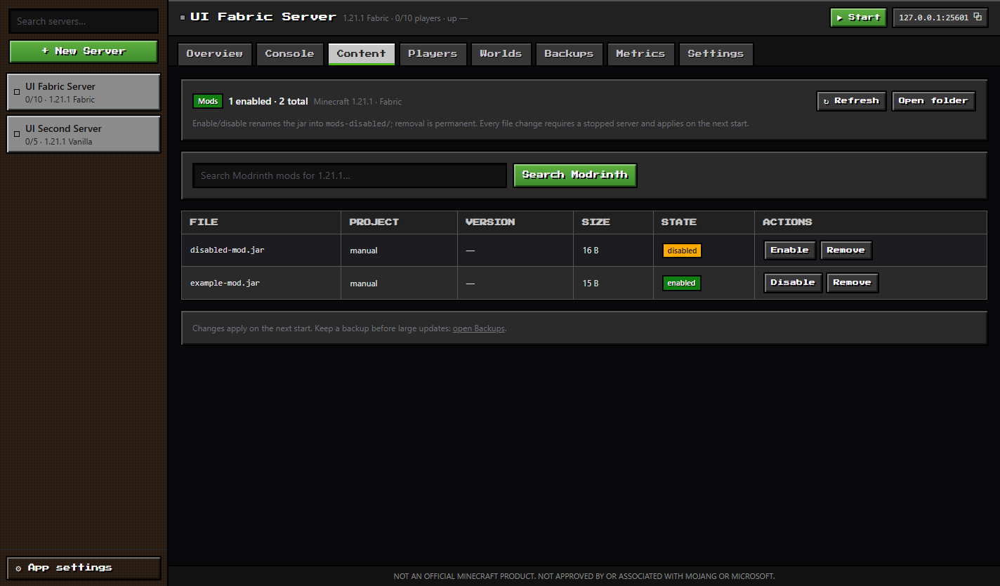
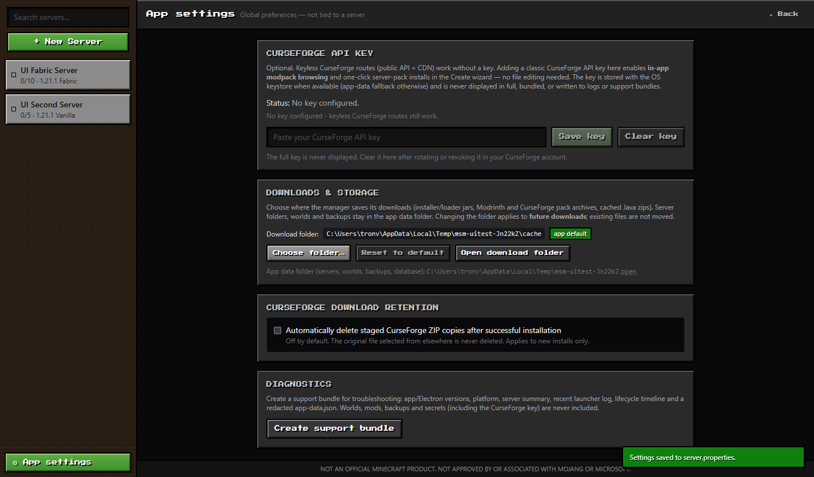

# Block Server Manager

[](LICENSE)
[](https://github.com/tuanvu17112003/block-server-manager/actions/workflows/verify.yml)
[](#requirements)
[](https://www.electronjs.org/)
[](https://www.typescriptlang.org/)

Desktop Minecraft server manager — **Electron + TypeScript + React**.

Create and manage Minecraft servers (Vanilla, Paper, Fabric, Forge, NeoForge), install Modrinth, CurseForge,
FTB and packwiz modpacks, and operate them: console, players, worlds, backups, metrics and content management.



## Why this exists

Most server managers either hand you a folder and a batch file, or hide everything behind a menu. This one treats a
Minecraft server as something you *operate*: it installs the pack, works out the correct Java runtime, diagnoses why a
server failed to boot, and keeps the console, players, worlds and backups in one place.

It also does something less common — it is explicit about how much it can prove. Every modpack format carries an
**evidence grade**, and only a format that has installed and booted a real pack end-to-end is described as supported.
A grade you can trust is more useful than a longer list of logos.

## Screenshots

| Console | Content management |
|---|---|
|  |  |

| App settings |
|---|
|  |

## Supported modpack formats

Formats are described by an **evidence grade** (`docs/audit/19`): how strongly the support is *proven*, not how
good the format is. Only `E1`/`E2` are presented as verified in the UI; a lower grade is shown as unproven rather
than hidden, and a format whose plan downloads no files is shown as a launcher instance rather than "verified".

| Format | Grade | What the grade rests on |
|---|---|---|
| **Modrinth** `.mrpack` | E2 | Real packs installed end-to-end through the adapter layer with a verified boot |
| **CurseForge** (key mode + author server pack) | E2 | Installed end-to-end with verified boots (part of the 12-pack matrix) |
| **FTB** | E2 | Installed end-to-end against the live API |
| **packwiz** (archive; HTTP tree) | E2 (archive) | A real zipped pack installed end-to-end; HTTP-tree shape resolves |
| **Prism / MultiMC** instance | E2 (metadata) | A real third-party instance export resolves correctly; a Prism instance carries no server payload, so the UI labels it as a launcher instance |
| **ATLauncher** instance | E2 (metadata) | A real user-published `instance.json` is recognised and distinguished from FTB |
| **ServerPackCreator** output | E3 | Real 1 GB archive resolves from its declared manifest |
| **Bare server zip** | E3 | Resolves and classifies; plans no downloads |

Deferred with recorded reasons (`scripts/conformance-waivers.json`): MCBBS, HMCL server, GDLauncher, Technic.
Supplying one of these produces an explanation naming the format and the reason, not a generic error.

## Download

Grab the latest build from the [releases page](https://github.com/tuanvu17112003/block-server-manager/releases/latest).
Two Windows builds are published, and the difference matters:

| Build | Use it when | Where it keeps your servers |
|---|---|---|
| `Block-Server-Manager-x.y.z-Setup.exe` | Normal use on your own PC | `%APPDATA%\Block Server Manager\data` — survives updates |
| `Block-Server-Manager-x.y.z-Portable.exe` | USB stick, another PC, no installation wanted | `data\` **next to the exe** — move the folder and the servers move with it |

The portable build is genuinely portable: it keeps everything in a `data` folder beside the executable, so copying the
whole folder to another machine brings your servers, settings and backups with it. If that location is not writable —
a write-protected USB stick, a read-only share, or an install under `Program Files` — the app says so at startup
instead of failing later with a permission error.

Both builds are unsigned, so SmartScreen will warn that the publisher is unknown. Choose **More info → Run anyway** if
you are comfortable doing so. Java is not a prerequisite: a matching 64-bit Temurin runtime is downloaded per server
when one is missing.

Prefer to build it yourself? See [Run](#run) below.

## Requirements

- Windows 10/11 x64. The installer and portable builds need nothing else — no Node.js, no system Java.
- Building from source needs Node.js 20+ and npm.
- Internet access for version/provider metadata, server/loader downloads and Java (Temurin) provisioning.
- No system Java is required: a matching 64-bit Temurin runtime is downloaded per server when missing
  (Settings/Create can pin a JDK path instead; majors 8/17/21/25 are supported).

## Run

```powershell
npm install
npm run dev        # Vite dev server (1420) + Electron
npm run build      # electron tsc + renderer tsc + Vite build
npm start          # build then launch Electron
```

Browser-only development requires an explicit opt-in mock backend (nothing uses mock data implicitly):

```powershell
$env:VITE_MOCK_BACKEND='1'; npm run dev:web
```

## Verify (do not trust "it builds")

```powershell
Remove-Item Env:ELECTRON_RUN_AS_NODE -ErrorAction SilentlyContinue   # agent/DSH shells only
npm run verify       # 15 steps: build, unit, conformance, adapter audit, real-artefact E2 checks, encoding,
                     #   contract, services, lifecycle, management, IPC, real-UI E2E
npm run verify:full  # adds the live engine E2E install matrix (network + Java)
```

Two of those steps exist because unit tests cannot catch their failure mode:

- **`conformance`** (`scripts/conformance-spec.mjs`) reads the design document and fails when the code disagrees
  with it, attributing every finding to a `file:line`.
- **`encoding`** (`scripts/check-encoding.mjs`) fails when a source file contains double-encoded UTF-8. Mojibake
  inside a string literal compiles and passes every test, so only an explicit check catches it.

Layers, artifacts and manual acceptance: [docs/verification.md](docs/verification.md). UI E2E writes
screenshots under `artifacts/<timestamp>/`.

## Package (Windows)

```powershell
Remove-Item Env:ELECTRON_RUN_AS_NODE -ErrorAction SilentlyContinue
npm run pack:dir               # build + unpacked app in release/win-unpacked/
npm run pack:verify            # packaged app: --selftest + --mgmttest
npm run pack:win               # NSIS installer + portable exe in release/
npm run pack:verify:installer  # silent install -> installed self-tests -> silent uninstall
```

`npm run pack:win` produces two artefacts. `electron-builder --win nsis portable` builds only one of them if you are
iterating on packaging — note that passing the targets explicitly is needed, because the `win.target` list in
`electron-builder.yml` is honoured by `npm run pack:win` but a bare `electron-builder` invocation can build only the
first target depending on version.

The installer is unsigned (SmartScreen "Unknown publisher"), per-user, and keeps app data on uninstall. The portable
exe keeps its data in `data\` beside itself; the data-root decision lives in `electron/services/paths.ts` and is pinned
by `electron/test/unit/portable-data-root.test.ts`, because a portable build that quietly writes to `%APPDATA%` would
appear to work and then lose every server the first time the folder is moved.
Details, artifacts and verification: [docs/packaging.md](docs/packaging.md).

## Data and secrets

- Dev data root: `<repo>/.app-data/`; packaged app: `<userData>/data/`.
- One-shot legacy Tauri import: on first run, if `<APPDATA>\com.blockserver.manager` contains an
  `app.db`, the app imports its servers/backups/history/settings into the JSON store when the target is
  empty (source is left untouched; a marker `legacy-import.json` records the report, and
  `legacy-import-plan.json` is written instead when the target already has servers).
- CurseForge API key: sidebar **⚙ App settings** → CurseForge API key (encrypted with Electron
  `safeStorage`, app-data fallback managed automatically — no file editing). Adding a key enables
  **in-app CurseForge modpack browsing** in Create; keyless Modrinth/CurseForge routes keep working
  without a key. The key is never bundled, logged, or included in support bundles.
- Downloads: **App settings → Downloads & storage** chooses where installer/loader jars, Modrinth and
  CurseForge archives and cached Java zips are written (default `<dataRoot>/cache`). Server folders,
  worlds and backups always stay in the app data root shown there.
- Global preferences (API key, download folder, CurseForge ZIP retention, diagnostics) live in the
  separate **App settings** section; the per-server **Settings** tab only edits that server.

## Project layout

```
electron/        Electron main process (IPC router, services, installer engines, tests under test/)
shared/          Shared contract types (command list + DTOs)
src/             React renderer (tabs, Create wizard modules, store, backend adapters)
scripts/         Verification runner, security audit, packaging verification + build-data checks
docs/            Specs, ADRs, audits, verification + packaging guides, completion plan
build/           App icons used by electron-builder (from the archived Tauri tree)
release/         Packaged output (git-ignored): installer + win-unpacked
legacy/src-tauri/  ARCHIVED Tauri/Rust reference (not built; parity reference)
```

## Documentation map

- [Completion plan + phase log](docs/electron-completion-plan.md)
- [Verification guide](docs/verification.md)
- [Tab/UX spec](docs/specs/app-tabs.md) · [Management/content spec](docs/specs/management-content.md)
- [Playwright MCP real-app test brief](docs/testing/playwright-mcp-test-brief.md) · launcher: `scripts/start-test-app.ps1`
- [Packaging guide (NSIS)](docs/packaging.md) · [Security audit](docs/audit/08-security-audit.md)
- [Architecture overview](docs/architecture/overview.md) · [ADRs](docs/architecture/adr/)
- [Audit reports (evidence + parity)](docs/audit/01-backend-runtime.md)
- [Deviations register — 47 recorded deviations](docs/audit/24-deviations-register.md)
- [Final synthesis — what was actually broken, ranked](docs/audit/25-final-synthesis-bottlenecks.md)
- [Evidence standard (E1–E4 grades)](docs/audit/19-stop-and-analyse-evidence-standard.md)

## Troubleshooting

- **"Backend bridge unavailable"**: the Electron preload failed to load; rebuild (`npm run build`) and
  restart. The app refuses to run on mock data in that state.
- **Port conflict at start**: the configured port is occupied; the start fails closed instead of silently
  changing the port. Choose a free port in Settings (Create uses `port_check` + suggestions).
- **App quit with a running server**: quit performs a bounded graceful stop (5 s) then kills the process
  tree; if a crash left an orphan, the next launch verifies the JVM identity marker before killing it.
- **Java download fails**: check network/proxy; Settings → Java lets you pin an installed 64-bit JDK.
- **Modded server crashes on boot**: managed packs auto-disable attributed client/broken mods and retry;
  unmanaged servers are never modified automatically (see console/crash-report hints instead).
- **SmartScreen warns about the installer**: packaged builds are unsigned; choose "More info → Run anyway"
  or provide a code-signing certificate before public distribution ([docs/packaging.md](docs/packaging.md)).

## Contributing

Contributions are welcome. Start with [CONTRIBUTING.md](CONTRIBUTING.md) — it is short, and it explains the one rule
that shapes everything here: **claims must be backed by evidence**. A passing test suite is not proof that a feature
works; this project has the scar tissue to show it.

Before opening a pull request, run the gate:

```powershell
npm run verify
```

Found a security problem? Please report it privately through the [Security tab](https://github.com/tuanvu17112003/block-server-manager/security)
rather than as a public issue — see [SECURITY.md](SECURITY.md).

Participation is covered by the [Code of Conduct](CODE_OF_CONDUCT.md).

## License

[MIT](LICENSE) © 2026 tuanvu17112003

You are free to use, modify, and distribute this software, including commercially, provided the copyright notice and
permission notice are retained.

---

NOT AN OFFICIAL MINECRAFT PRODUCT. NOT APPROVED BY OR ASSOCIATED WITH MOJANG OR MICROSOFT.
