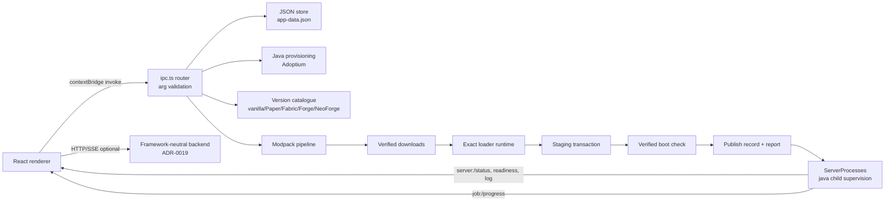

# Overview — Block Server Manager (Electron desktop)

The app is an **Electron + TypeScript + React** desktop manager. The Electron main process owns
persistence, Java provisioning, provider downloads, staged installation, process supervision and event
channels; the React renderer (Vite + Tailwind) drives setup and lifecycle controls. The former Tauri/Rust
tree (`src-tauri/`) is dormant reference code and is not built or shipped
([ADR-0020](adr/0020-electron-sole-runtime.md)).

## Runtime map

| Area | Location | Notes |
|---|---|---|
| Entry / window | `electron/main.ts` | sandbox + contextIsolation, CSP, navigation/window-open allowlists, single-instance lock, bounded quit shutdown, test-mode isolation |
| Bridge | `electron/preload.ts` | minimal `electronAPI.invoke/on` + native pickers; channel allowlist |
| Command router | `electron/ipc.ts` | 66 renderer commands, sender-frame policy, `validate-ipc.ts` arg validation, `{code,message}` envelope |
| Contracts | `shared/contracts.ts` | canonical command list + DTOs shared by main/renderer checks |
| Persistence | `electron/services/store.ts` | `<dataRoot>/app-data.json`, atomic write (tmp+fsync+bak), corrupt quarantine, cascade delete, legacy Tauri importer |
| Process control | `electron/services/server-process.ts` | fast-ack start, readiness events, identity marker + CIM reaping, tree kill, bounded ring + monotonic seq |
| Install pipeline | `electron/services/pipeline.ts`, `installer/`, `install-transaction.ts` | plan/report DTO, source-pin drift guard, verified boot before publish, L1–L4 client-mod defense |
| Management | `backups.ts`, `worlds.ts`, `players.ts`, `metrics.ts`, `content.ts` | see [management/content spec](../specs/management-content.md) |
| Diagnostics | `electron/services/diagnostics.ts` | rotating launcher log, JSONL timeline, support bundle |

## Data

- Dev: `<repo>/.app-data/`; packaged: `<userData>/data/` — server folders under `servers/<id>/`, backups,
  metrics, logs, `app-data.json`.
- One-shot legacy Tauri import on first run when the target store is empty (source untouched; report marker).
- Secrets: CurseForge key in `safeStorage` or `<dataRoot>/curseforge-key.txt`; never bundled/logged.
- EULA acceptance is explicit (file truth + flag); RCON/loopback deferred (ADR-0011); no Docker; no bundled
  Mojang assets (IP red lines).

Verification: [docs/verification.md](../verification.md). Plan/status: [completion plan](../electron-completion-plan.md).
