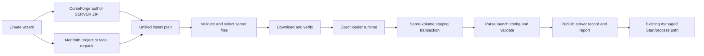

# Overview — MC Server Manager (Desktop)

The app is a Tauri 2 + React (Vite) + Tailwind + shadcn desktop manager. Rust owns server persistence, Java provisioning, provider downloads, staged installation, process control, and console events; the React UI drives server setup and lifecycle controls.

The diagram is the target flow in [ADR-0016](adr/0016-modpack-setup-pipeline-rebuild.md) and [the overhaul specification](../specs/modpack-server-setup-overhaul.md). The older provider-specific implementation remains active until the replacement passes review and regression gates.

Server records live in SQLite and managed server folders under app data. The product remains desktop-native and does not use Docker. EULA acceptance remains explicit, RCON is loopback-only, and the server process manager remains the only Start path.
